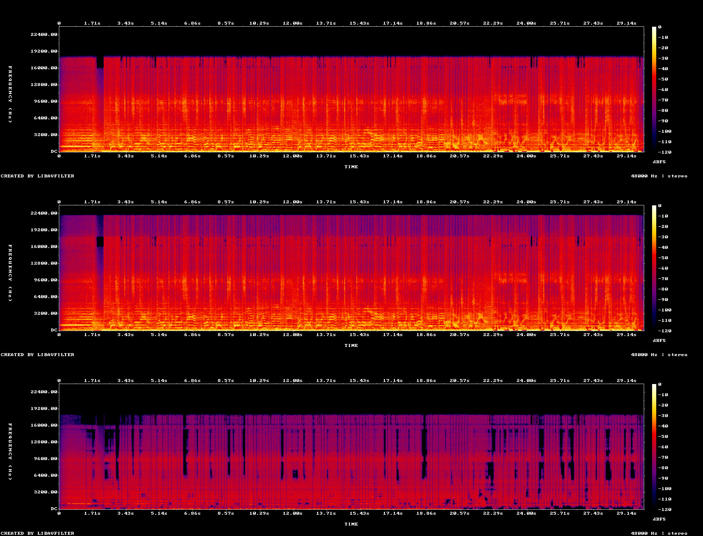

# sunscreen ☀️

*Protection from Suno haze.*

Cleans up tracks downloaded from Suno. It's a single Rust binary (or a drag-and-drop Mac app) that reads MP3 or WAV and writes 24-bit WAV.

## What it does

Suno songs share a few audible flaws. sunscreen fixes each one in a separate, gentle step, and writes a file after every step so you can hear exactly what each one did:

1. **Removes the decoder buzz** (automatic). Suno's decoder leaves a faint, steady buzz that repeats exactly every 5 ms. sunscreen detects it and subtracts it precisely, leaving the music around it untouched. It only acts when it finds the buzz; `--no-debuzz` turns it off.
2. **Removes the haze.** Suno renders sit on a grainy static, like a radio slightly off-station, strongest in the highs. sunscreen tracks how loud that static is moment by moment (it rises and falls with the music) and turns it down where you'd actually hear it. It leaves alone the static the music already covers, and steps aside on drum hits so they keep their snap.
3. **Steadies what's left** (`--smooth`). The static doesn't just sit there; it flutters. Evening out the flutter removes most of the "off-station" character without cutting any more.
4. **Widens the top end** (`--widen`). Suno's highs collapse to near-mono. sunscreen gives the cymbals and air back the same width the rest of the track already has. The mono fold-down is unchanged.
5. **Rebuilds the missing top octave** (`--excite`). Suno's MP3s stop dead at about 18 kHz. sunscreen fills that region from the music just below it, the way HE-AAC does.
6. **Balances the tone like a commercial master** (`--match`). Each Suno track comes out with its own tilt (one boomy, one harsh). sunscreen compares it with the average of 12 commercially mastered pop songs and corrects it gently (±3 dB at most, without changing loudness). Or give it a song you love: `--match=ref.wav`.
7. **Masters the level** (`--master`). Suno tracks arrive anywhere from −11.6 to −15.6 LUFS. sunscreen sets them all to the streaming standard (−14 LUFS) with a true-peak limiter at −1 dBTP, so an album plays at an even level and survives Spotify's re-encoding without clipping.

Every step exists because a measurement on real Suno tracks showed the problem. Ideas that measured as non-problems (spectral holes, phase smear, soft attacks, repeat averaging) were dropped. [docs/](docs/README.md) explains exactly how every step works, and [docs/findings.md](docs/findings.md) has the measurements.

## Hear it

30 seconds of *Glass Hearts & Gasoline* (a Suno track; hear the whole song and the rest of the release at [sidetrax.fm/releases/love-this](https://sidetrax.fm/releases/love-this)), processed with sunscreen v0.6 and the recommended chain `--smooth --widen --excite --match --master` (debuzz runs automatically). 16-bit FLAC; the links download:

- [Before](https://github.com/abradburne/sunscreen/releases/download/v0.6.0/glass-hearts-30s-before.flac): the Suno MP3, untouched
- [After](https://github.com/abradburne/sunscreen/releases/download/v0.6.0/glass-hearts-30s-after.flac): sunscreen's output (−14 LUFS)
- [After + mastering](https://github.com/abradburne/sunscreen/releases/download/v0.6.0/glass-hearts-30s-after-mastered.flac): the same chain mastered louder with `--master=-9`, like a commercial single (−9 LUFS, −1 dBTP)
- [Removed](https://github.com/abradburne/sunscreen/releases/download/v0.6.0/glass-hearts-30s-removed.flac): what debuzz and the denoiser took out (it should sound like hiss and a faint buzz, not music)



*Top: before. The MP3 stops dead at 18 kHz. Middle: after. The top octave is rebuilt up to 22 kHz, and the tonal balance is matched. Bottom: what was removed. The decoder buzz runs through the whole clip as a fine comb of steady horizontal lines (multiples of 200 Hz), over the broadband haze.*

## Quick start

**Homebrew (macOS, Linux):**

```sh
brew install abradburne/tap/sunscreen
```

**Mac app (no terminal):** download `Sunscreen-<version>-macos.zip` from the GitHub Releases page, unzip, and move `Sunscreen.app` to Applications. Drop MP3 or WAV files on its icon; results land in a `sunscreen` folder next to each file (recommended settings: `--smooth --widen --excite --match --master`), and Finder opens it when done. The app isn't notarised, so the first time, run `xattr -dr com.apple.quarantine /Applications/Sunscreen.app` (or right-click → Open).

**Prebuilt binaries:** grab the archive for your platform from the GitHub Releases page (macOS arm64/x86_64, Linux x86_64/arm64, Windows x86_64), unpack it, and put `sunscreen` on your PATH. On macOS, clear the download quarantine once: `xattr -d com.apple.quarantine sunscreen`.

**From source:**

```sh
# install Rust once (skip if `cargo --version` works)
curl --proto '=https' --tlsv1.2 -sSf https://sh.rustup.rs | sh

# build and put `sunscreen` on your PATH (~/.cargo/bin)
cargo install --path .

# recommended: everything on
sunscreen "My Song.mp3" out --smooth --widen --excite --match --master
```

A 5-minute track takes about 10 seconds on a laptop.

Do a whole folder:

```sh
for f in *.mp3; do sunscreen "$f" cleaned "${f%.mp3}" --smooth --widen --excite --match --master; done
```

## Usage

```
sunscreen <in.wav|in.mp3> [out_dir] [title] [--no-gate] [--no-debuzz] [--smooth[=ms]] [--widen[=x]] [--excite[=dB]] [--match[=ref.wav]] [--master[=LUFS]]
```

| Argument | Default | Meaning |
|---|---|---|
| `in` | — | MP3 or WAV (16/24/32-bit int or float), any sample rate, mono or stereo. For FLAC/M4A, convert first: `ffmpeg -i song.m4a song.wav` |
| `out_dir` | the input's folder | Where outputs go (created if missing) |
| `title` | the input's file name | Prefix for output file names |

The input length and sample alignment are kept exactly. Only `--match` changes tone, and only `--master` changes level. Without `--master`, if a stage pushes a sample past full scale, the run prints `CLIPPING` instead of turning the track down.

## Output files

Each run always writes:

| File | What it is |
|---|---|
| `<title> - Clean.wav` | The denoised track. Every output file also gets a 5 ms fade at each end: Suno files often start or stop mid-sound, which clicks on play and stop. |
| `<title> - Removed Noise.wav` | Original minus Clean, sample for sample. Listen to it to hear what was taken. If you hear drums or vocals in it, the denoise is taking music. |
| `<title> - Spectrogram.png` | The densest 10 s: original, removed, and (with `--excite`) the `--excite` output (before `--match`), each panel normalised separately |
| `<title> - Report.txt` | The run report printed in the terminal, saved for later |

Each optional stage then writes a **cumulative** file, so you can A/B one step at a time:

```
Clean → Clean+smooth → Clean+smooth+widen → Clean+smooth+widen+excite → …+match → …+master
```

The stages always run in that order. A file name lists only the stages you turned on, so `--widen --excite` gives `Clean+widen` and `Clean+widen+excite`.

The run also prints a report: the parameters used, the STFT round-trip error (should be about 1e-16), peak levels, RMS change, attenuation per band, and how much the removed signal follows the music (`env corr`).

## What each stage does, and why

### Debuzz (automatic) — remove the decoder's buzz

**Problem:** Suno's decoder works on a 5 ms grid (240 samples at 48 kHz) and leaves a waveform that repeats exactly on it for the whole song: a faint buzz at 200 Hz and its harmonics, about 20 dB under the music's high end. Found in 3 of 4 Suno tracks and in none of the human masters tested.

**How:** measures how far a 240-sample repeat stands above chance (Suno: +21 to +23 dB; human masters: about −1 to −2 dB). Above 6 dB it takes the waveform's shape from the whole song, fits its level every 4 seconds, and subtracts it. Wherever that template would outweigh the music it sits in, it backs off, so a held note that happens to land on the grid can't ring.

**Measured:** removes −46 to −52 dBFS of buzz. Against a known buzz added to clean human masters, the error is 3 to 13 dB under the buzz, where v0.7's per-window estimate added about as much music damage as it removed. Nothing else in the chain changes, and drum hits are untouched. Details, and how it was found, in [docs/debuzz.md](docs/debuzz.md).

### Denoise (always on)

**Problem:** Suno renders sit on a broadband haze that's strongest in the highs.

**How:**
- **Noise floor:** a *rolling* estimate. Per 1-second block, take the 15th-percentile power in each frequency bin, smooth that across about 4 s, and scale it by 0.8 to stay gentle. A single global profile from the "quietest" frames doesn't work, because a full mix has no noise-only moments, so that profile ends up being quiet music.
- **Gain:** power subtraction, `g = sqrt(max(1 − α·noise/power, 0))`. α is 1 below 3.5 kHz and ramps to 2 by 7 kHz.
- **Maximum cut per band:** 1 dB below 300 Hz, 3.5 dB from 450 Hz to 3.5 kHz, 7 dB above 7 kHz. The steps between are smooth crossfades.
- **Smoothing:** the gain mask is blurred across time and frequency to prevent the "musical noise" warble.
- **Stereo:** one mask for both channels, so the stereo image can't shift. The original phase is kept.
- **Drum-hit protection:** detected hits (about 3–5 per second) get no cut for about 40 ms. Without this, the blur pulls attenuation from the quiet frames before a hit onto the attack and dulls it. The hit itself covers any haze let through.

**Expect:** about −0.2 to −0.7 dB overall, more in the highs. It's subtle by design.

### Hearing-model gate (on by default; `--no-gate` turns it off) — only cut haze you can hear

**Problem:** 42–83% of what the denoiser removed (by energy) was haze already *masked* by louder music: inaudible, and exactly where cutting damages the music.

**How:** a hearing model (Johnston-style) estimates, in each frame and critical band, the level below which the music hides other sound. It sets that level from whether the music is tonal (a held vocal note hides little) or noise-like (hides more). The cut is then scaled by how audible the haze is: none where it's masked, full where it's exposed.

**Measured:** wasted removal drops 48–80%, while 99% of the removal of *audible* haze is kept. On Glass Hearts, how closely the removed signal follows the music falls from 0.549 to 0.419 (less music taken), and the vocal-melody lines mostly vanish from the removed signal.

**If it breathes:** if you hear the haze texture switching on and off as vocal phrases start and stop, compare with `--no-gate`, which cuts everywhere the haze is above the floor.

### `--smooth[=ms]` — steady out the static (default 85 ms)

**Problem:** the haze *flutters*, which is the "off-station radio" quality. Plain denoising makes it worse: power subtraction cuts the quiet dips harder than the peaks, which made the flutter 1–1.2 dB more pronounced on Glass Hearts.

**How:** this is the same idea as AAC's noise substitution (in noise-like bands the ear hears level, not waveform). Wherever haze dominates a bin, its level is pulled toward its own short moving average. It keeps the original phase, uses one gain for both channels, caps changes at ±6 dB, and fades the effect out as a bin rises above the floor, leaving bins ≥4× above it (music, hits) alone. The floor is re-measured on the denoised audio.

**Measured:** flutter in the 3.5–12 kHz haze goes from 6.97/8.60 dB (Clean) to 5.19/6.45 dB, below the original. Overall level changes by +0.1 dB.

**Tuning:** sounds watery → `--smooth=40`; grit still there → `--smooth=150`.

### `--widen[=x]` — restore stereo width in the highs (default x = 1)

**Problem:** every Suno track tested collapses toward mono at the top. Above 16 kHz, left and right are 0.97–0.999 identical, while the mids are clearly wider. The WAV downloads do it too, so it comes from Suno's generator, not the MP3 export.

**How:** above 10 kHz (ramped in by 12 kHz), a 5 ms-delayed copy of the centre (mid) signal is added to the side signal. That's just enough to bring each band up to the track's *own* width in 3.5–13 kHz, times `x`. Only the side changes, so **L+R (the mono fold-down) is unchanged** (to floating-point rounding).

**Measured (Glass Hearts):** above 16 kHz, side relative to mid goes from −18.0 to −8.6 dB (target −7.9). Nothing below 10 kHz changes.

**Tuning:** sounds phasey on headphones → `--widen=0.5`. 7–10 kHz is left narrow on purpose, to keep "s" sounds centred.

### `--excite[=dB]` — rebuild the top end above the MP3 cutoff (default −3 dB)

**Problem:** Suno MP3s stop at about 18 kHz (the WAVs at about 20 kHz).

**How:** spectral band replication, the trick HE-AAC uses:
- **Find the cutoff:** where the long-term spectrum falls 25 dB below the 8–12 kHz level.
- **Copy:** the band just below the cutoff (ending at 0.8× the cutoff, so about 9–14 kHz for an 18 kHz cutoff) is copied up into the empty region, frame by frame, so the new highs follow the music's hits.
- **Level:** the added content continues the track's own fitted high-frequency slope, plus the `dB` offset. Only the power that's *missing* is added, so real content isn't doubled.
- **Phase:** the shift is a multiple of 4 bins, which keeps the copied partials phase-coherent from frame to frame.

If no cutoff is found, the stage is skipped.

**Measured (Warm Current):** 20–22 kHz goes from −87 to −16 dB, with a smooth roll-off and no notch at the cutoff.

**Limit:** it adds plausible "air", not the real lost detail. If cymbals turn metallic, try `--excite=-6` or `-9`.

### `--match[=ref.wav]` — tonal balance like a commercial master

**Problem:** every Suno track comes out with its own tonal tilt, and they don't share one. Against 12 commercially mastered pop tracks, Glass Hearts wants 2–3 kHz pulled down about 2 dB, while French Exit wants that region lifted about 5 dB. A fixed "de-Suno EQ" would fix one and wreck the other.

**How:** compares the track's long-term spectrum with a target and applies the difference as a static EQ:
- **Target:** with plain `--match`, the built-in average of those 12 masters (they agree within 1–2.7 dB from 125 Hz to 10 kHz). With `--match=song.wav`, that one track instead.
- **Smooth and gentle:** the correction is averaged over one octave, so it shapes tone rather than notching notes, and capped at ±3 dB.
- **Level-neutral:** the average correction (weighted by the track's own energy) is removed, so overall level stays about the same; it rebalances rather than boosts.
- **Range:** 40 Hz to 12 kHz, fading out beyond. Above 12 kHz the references disagree too much to be a target, and the exciter owns that region anyway.

The run prints the applied correction at 63 Hz to 16 kHz.

**Measured:** for each Suno track, the built-in target's correction lands within 0.7 dB of the average of 12 single-reference corrections.

**Status:** opt-in, in the recommended command. To aim at your own genre instead, match a song you love: `--match="Reference Song.wav"`.

### `--master[=LUFS]` — streaming-ready level (default −14 LUFS)

**Problem:** Suno's loudness is all over the place (−11.6 to −15.6 LUFS on four tracks), so an album jumps in level. Streaming services normalise to about −14 LUFS, and a file that peaks at 0 dBFS *between* samples can clip once they re-encode it.

**How:**
- **Measure:** integrated loudness per ITU-R BS.1770-4, the standard every LUFS meter uses (K-weighting, 400 ms blocks, −70 LUFS and −10 LU gates).
- **Gain** to the target.
- **True-peak limiter:** looks at the peaks between samples (4× oversampled), ceiling −1 dBTP. It looks 2 ms ahead, so the gain eases down before each peak instead of snapping, and recovers over 80 ms. Linked across channels, so the stereo image stays put.
- **Iterate:** limiting removes a little loudness, so it re-measures and corrects until it's within 0.05 LU of the target.

**Measured:** readings match ffmpeg's independent meter to 0.1 dB. At −14 LUFS the limiter barely touches Suno tracks; it's mostly a level match. At `--master=-9`, Glass Hearts takes 4.4 dB of limiting and still lands at exactly −9.0 LUFS / −1.0 dBTP, with no measurable dulling of drum hits.

**Tuning:** louder for club or radio: `--master=-9`. If the run warns about heavy limiting (over 6 dB), back the target off.

## A/B workflow

1. Load the original, `Clean`, and each `Clean+…` file into your DAW, level-matched.
2. Compare one step at a time (Clean → +smooth → +widen → +excite), on headphones and speakers.
3. Solo `Removed Noise`: it should sound like hiss. Drums or vocals in it mean music is being taken.
4. Wet/dry trick: put `Removed Noise` under the original with its polarity flipped. Its fader then works as a dry/wet control between Original and Clean.

## Diagnostics

Each one prints a measurement and exits without writing audio. They're how every decision in this README was made; rerun them after changing anything.

| Flag | Measures | Use it to |
|---|---|---|
| `--audibility` | Share of removed energy where the haze is masked / borderline / audible, gated vs ungated | Check that the gate saves wasted removal |
| `--flutter` | How much the haze level jumps around (~85 ms readings), against a steady-noise baseline | Check `--smooth`. Only stage-to-stage comparisons are fair. |
| `--width` | L/R coherence and side/mid ratio per band | Check `--widen`; spot collapsed highs |
| `--attacks` | Median 10–90% attack rise time and energy before the peak at detected hits | **Regression check**: make sure the chain doesn't dull drums |
| `--holes` | Rate of MP3 "spectral holes" per band | Only matters for files at 96 kbps or below |
| `--phase` | Phase coherence around tonal peaks | Spot "phasey" sustained notes |
| `--modspec` | How the haze level fluctuates (modulation spectrum), with readings at neural-codec and MP3/AAC frame rates | Look for a codec fingerprint (none found on Suno) |
| `--floors` | Noise floor against music level, loud to quiet | Check whether haze is a fixed floor or follows the music (on Suno: follows it) |
| `--tone=ref.wav` | The `--match` correction without the ±3 dB cap (`--tone=pop` for the built-in target) | See how a track's balance differs from a reference without rendering |
| `--profile` | Third-octave long-term spectrum | Build your own target from tracks you like |
| `--repeats` | How similar repeated sections are, and whether their waveforms line up | Explains why repeat-averaging can't work on Suno |

```sh
sunscreen "My Song.mp3" /tmp --width
```

## Tuning constants

Beyond the flags, the knobs are constants near the top of `src/main.rs` (rebuild after editing):

| Constant | Default | Effect |
|---|---|---|
| `FLOOR_KNOTS` | 1 / 3.5 / 7 dB | Maximum denoise cut per frequency region |
| `ONSET_K` | 2.0 | Hit-detection sensitivity (higher = fewer hits protected) |
| `GATE_RAMP_DB` | 3.0 | Width of the masked→audible crossfade |
| `SMOOTH_SNR`, `SMOOTH_LIMIT_DB` | 4×, ±6 dB | Which bins count as haze, and how far smoothing may move them |
| `WIDEN_FROM_HZ`, `WIDEN_MAX_G`, `WIDEN_DELAY_MS` | 10 kHz, 0.5, 5 ms | Where widening starts, its cap, and the decorrelation delay |
| `CUTOFF_DROP_DB`, `EXCITE_TOP_HZ` | 25 dB, 22 kHz | Cutoff detection, and how high the exciter fills |
| `MATCH_MAX_DB`, `MATCH_SMOOTH_OCT`, `MATCH_RANGE` | ±3 dB, 1 octave, 40 Hz–12 kHz | How far, how smoothly, and where `--match` corrects |
| `MASTER_DEFAULT_LUFS`, `TRUE_PEAK_DBTP` | −14 LUFS, −1 dBTP | `--master` target and peak ceiling |
| `LIMIT_ATTACK_MS`, `LIMIT_RELEASE_MS` | 2 ms, 80 ms | Limiter look-ahead and release |
| `POP_TARGET` | 12-track average | The built-in `--match` target; replace with your own `--profile` averages |

## What it can't do

- **Saturation and distortion** are nonlinear. Spectral processing can't undo them.
- **MP3 losses** are gone for good. `--excite` makes up plausible highs; it doesn't recover the originals. Download WAV from Suno if your plan allows it.
- **Mix problems** (muddy balance, harsh vocals) need stems. Running sunscreen on each stem separately and remixing is the next step up.
- The bigger idea is a small neural model trained to undo Suno's codec fingerprint.

## Development

```sh
cargo test --release    # 15 tests: STFT round trip, each stage's intended effect, and that it fails when disabled
cargo build --release   # binary at target/release/sunscreen
```

Everything is in `src/main.rs`. Dependencies are `hound` (WAV writing), `symphonia` (MP3/WAV decoding), `realfft` and `png`.

## License

MIT. See [LICENSE](LICENSE).
